<h1 align="center">
  
</h1>

## 👋 About me

I'm a **software engineer** from Makassar, Indonesia 🇮🇩. I build backend systems, design REST and GraphQL APIs, and integrate AI into apps.

I enjoy working on event-driven systems, from routing sensor data to delivering real-time alerts.

  
  
  
  

 

## 💥 Projects

### [Predictive Maintenance Gateway ↗](https://github.com/andikaPalian/predictive-maintenance-gateway)

An event-driven IoT platform that turns equipment telemetry into real-time anomaly alerts. RabbitMQ queues sensor events, a Python service scores them, and the Node.js gateway broadcasts critical alerts via Socket.IO.

`Node.js` · `Express` · `FastAPI` · `RabbitMQ` · `Docker`

### Currently building

- **🤖 KIRA** — A personal AI companion for learning.

## ⚙️ Toolkit

Full toolkit

| Area | Tools |
| --- | --- |
| Backend & APIs | Node.js, NestJS, Express, Laravel, FastAPI · REST & GraphQL |
| AI & data | Python, TensorFlow, PyTorch, Jupyter, pandas, NumPy · Computer Vision & NLP |
| Databases & infrastructure | PostgreSQL, MongoDB, Redis, Prisma, Docker, Git |
| Frontend & design | React, Next.js, JavaScript, TypeScript, Figma |

> My first debugging breakpoint is sometimes a well-placed `console.log`.

## 📈 Contribution Pulse

[View contributions on GitHub ↗](https://github.com/andikaPalian#contributions)

---

Visual inspiration from <a href="https://finktheartist.tech/sakuga-vfx">Sakuga VFX</a> by Justin Finkelman.
